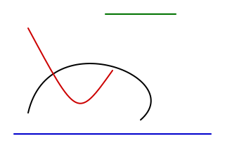

# Bezier Curve for Pinta

[中文文档](README.zh-CN.md)

[](../../actions/workflows/build.yml)

A Pinta add-in with a **Bezier curve tool**, inspired by KolourPaint's curve tool: drag
out a line, then bend it with one or two control points.



Works with **Pinta 3.1** on Linux, macOS and Windows as a normal add-in — no changes to
Pinta's source are required.

## Install

1. Download `PintaExtension-BezierCurve-<version>.mpack` from
   [Releases](../../releases/latest).
2. In Pinta: **A_dd-ins → Add-ins → Install from file…** and pick the `.mpack`.
3. Restart Pinta. A **Bezier** tool appears in the toolbox right after *Line/Curve*
   (shortcut **V**).

Uninstall the same way: **A_dd-ins → Add-ins → Installed →** remove
*Bezier Curve*.

> Copying the DLL into `~/.config/Pinta/addins/` by hand does **not** work: that
> directory is Mono.Addins' registry database, not a scan directory.

## Usage

| Action | Result |
|---|---|
| Drag with the left button | start / end point, drawn with the primary colour |
| Drag with the right button | the same, drawn with the secondary colour |
| Drag again (same button) | place the first control point |
| Drag once more | place the second control point — the curve is finished and stays adjustable |
| Drag any end or control point | reshape the curve while it is adjustable (the marker highlights and the cursor changes when it is grabbable) |
| **Enter** | finish the curve in progress |
| **Backspace** / **Delete** | take back the last point (and cancel the line) |
| **Arrow keys** (Shift = 10 px) | nudge the highlighted point |
| Drag somewhere else | finish the current curve and start the next one |
| Click the **other** button | finish early: 2 points give a straight line, 3 points a curve with one control point |
| Click the single control point again | finish a three point curve (the way MS Paint does it) |
| **Shift** while dragging the line | snap to 0° / 45° / 90° (the status bar shows the angle) |
| **Ctrl** while dragging the line | snap to 0° / 30° / 60° / 90° |
| **Shift + Ctrl** | snap to 0° / 30° / 45° / 60° / 90° |
| **Shift** while placing a control point | snap it to a construction point (see below) |
| **Ctrl** while placing a control point | snap the tangent of the curve at its end point |
| **C** | close the curve (it leads back to its start point) |
| **F** | fill the closed curve |
| **Esc** | cancel the curve in progress |
| **Ctrl + E** | pick the curve that was committed last up again and adjust it |
| `[` / `]` | decrease / increase the brush width |
| Dash pattern box | optional dashes in Pinta's dash/space notation (default: solid) |
| Behaviour box | what happens to a curve once it is finished (see below) |
| Commit box | when the curve is committed (see below) |
| Button with the gear | the stroke, the shape and the symmetry options (see below) |
| Button next to them | pick the curve that was committed last up again |
| Switch tool or document | the curve in progress is committed (like KolourPaint) |

While drawing, the status bar shows the point being placed, the number of points, the
size of the finished curve and the snapped angle.

The angle snapping is a 1:1 port of `kpToolPolygonalBase::applyModifiers()`, including
its "closest allowed angle" decision boundaries (the tangent of the angle halfway
between two allowed angles).

### The tool bar

| Option | What it does |
|---|---|
| **Brush width** | Pinta's own spin button. |
| **Dash** | The dash pattern of the curve; solid by default. |
| **Behaviour** | What happens to a curve once it is finished.<br>**KolourPaint** drops it onto the layer as paint, which is all the tool did until 0.6.0.<br>**MS Paint** keeps it an object with a selection frame around it (see below). |
| **Commit** | **Keep editable** (the default) leaves the finished curve adjustable until it is finished with Enter, the other mouse button or a new drag.<br>**Commit now** commits it as soon as the last control point is placed, the way MS Paint does it. |
| **Button** | Picks the curve that was committed last up again, so that it can be adjusted (Ctrl + E does the same). |

The tool bar is not the same in both behaviours: the two flip buttons only appear in the
**MS Paint** behaviour (and are greyed out while no object is being edited), and the
**Commit** box only appears in the **KolourPaint** behaviour.

### The style panel

The button with the gear in the tool bar opens a panel with the options of the stroke,
the shape and the symmetry:

| Option | What it does |
|---|---|
| **Start / End** | How each of the two ends of the stroke looks, picked on its own: round (a half circle over the end point), pointed (it tapers to a sharp point at the end point) or square. |
| **Join** | How the stroke turns: round, bevel or miter. |
| **Gradient** | The stroke runs from the colour of the mouse button that drew the curve to the other one. |
| **Start width / End width** | The width of the stroke at the start and at the end of the curve; 0 means "the brush width". A curve whose two widths differ is drawn in pieces, so it tapers. |
| **Closed curve** | The curve leads back to its start point. |
| **Smooth seam** | The closing segment continues the tangents of the curve instead of leaving a corner where it meets itself. |
| **Fill** | The area inside a closed curve is filled with the colour of the curve. |
| **Symmetry** | **Off**, **Mirror** (the second control point is the mirror image of the first one in the perpendicular bisector of the line between the two end points, which draws a symmetric leaf) or **Center** (it is the point symmetric to the first one around the middle of that line, which draws a symmetric S). Grabbing the point that was derived breaks the symmetry on purpose. |
| **Whole pixels** | Every point is put on a whole pixel. |

The **C** and **F** keys switch the closed curve and the fill while drawing.

### The object in MS Paint mode

In the **MS Paint** behaviour a finished curve does not become pixels straight away. As
soon as the last control point is placed it wears a dashed frame, and until that frame
goes away the curve is an object:

| Action | Result |
|---|---|
| Drag inside the frame | move the whole curve (the cursor turns into four arrows) |
| Drag a corner handle | change the width and the height at once |
| Drag an edge handle | change only one of them |
| **Shift** while dragging a corner | keep the proportions |
| Drag the round handle above the frame | turn the shape around its own middle |
| **Shift** while turning | snap the turn to 15 degree steps |
| The two flip buttons in the tool bar | mirror the object horizontally or vertically |
| Any appearance setting | applies to the object straight away |
| Click outside the frame | drop the curve onto the layer, where it becomes pixels |
| **Escape** | throw the object away |

The corner across from the handle being dragged stays where it is, so the shape grows
in the direction that is being dragged. The frame turns with the shape, and the handles
keep working in the shape's own directions, so a turned curve stretches along its own
edges rather than along the screen. Dropping the object is one undo step.

The frame goes away as soon as the object is dropped: after that the curve is pixels like
anything else, exactly as in MS Paint.

### Construction points

Holding **Shift** while a control point is placed (or an end point is dragged) snaps it
to the construction points of the classic MS Paint workflow: the edges and the centre
lines of the canvas, its corners, the grid (when the canvas grid is shown), the middle
and the thirds of the line between the two end points, the coordinates of the points
that are already placed, the end points of the curve that was committed last, and the
perpendicular bisector of the line between the two end points. That is how the original
tool is used - draw a guide line first, then put the control points exactly onto its
intersections.

Holding **Control** while a control point is dragged snaps the **tangent** of the curve
at the end point the control point belongs to: 0°, 30°, 45°, 60° or 90°.

### Picking a curve up again

The curve that was committed last can be adjusted again with the button in the tool bar
or with **Ctrl + E**. It is taken off the layer while it is edited and drawn again when
the edit is finished; **Escape** puts the old one back. Only the area that the curve
covers is restored, so anything that was painted in that area afterwards is lost.

**Ctrl + C** copies the curve that was committed last to the clipboard as an image,
the way MS Paint copies a shape. Without a curve, the usual copy of the layer happens.

### Deliberate differences from KolourPaint

* **Control point markers.** While a curve is in progress its end points are drawn as
  blue dots and its control points as magenta dots, connected by dashed leashes.
  KolourPaint shows nothing, which makes the shape hard to read while editing. The
  markers are drawn in window space (`IToolHandle`), so they keep a constant size at
  any zoom.
* **A finished curve stays adjustable.** KolourPaint commits as soon as the fourth point
  is placed; here the points can still be dragged until the curve is finished with
  Enter, the other mouse button or a new drag. The original gestures keep working.
  The tool bar can switch this back to the KolourPaint behaviour.
* **Escape cancels**; KolourPaint only cancels by releasing the buttons.
* **Antialiasing** uses Pinta's per-tool dropdown instead of a global setting.
* The **brush width** is a spin button (Pinta style) instead of a dropdown.
* The **ends** of a stroke can be pointed; Cairo has no such cap, so it is drawn as a
  stroke that grows from nothing at the two end points to the full width in the middle.
* **Dash patterns** are offered as an optional extra; KolourPaint's curve tool has none.
  They default to a solid line.
* **Closed curves, fills, gradients, tapered strokes and symmetric control points** are
  extras as well; KolourPaint's curve tool draws a single open stroke. They are all off
  by default, so the tool behaves exactly like before until they are switched on.

## Build from source

Requires the .NET 8 SDK and git. Pinta is cloned into `.pinta/` (git-ignored) because
only `Pinta.Core` is needed to compile the add-in:

```bash
./scripts/bootstrap-pinta.sh          # clone + build Pinta 3.1 into .pinta/Pinta
dotnet build src/TheMorbidArk.PintaExtension.BezierCurve/TheMorbidArk.PintaExtension.BezierCurve.csproj
./scripts/make-mpack.sh               # -> dist/PintaExtension-BezierCurve-<version>.mpack
```

If you already have Pinta somewhere else:

```bash
export PINTA_SRC=/path/to/Pinta
# or: dotnet build -p:PintaSourceDir=/path/to/Pinta
```

Developer install (copies the add-in next to Pinta's executable, which is the only place
a debug add-in is picked up from):

```bash
./scripts/dev-install.sh
```

### Upgrading

Install the new `.mpack` over the old one - no uninstall needed, and the tool stays in the
toolbox. Two things make that work:

* since 0.4.3 the assembly identity is deliberately frozen (`1.0.0.0`), so a stale
  extension node resolves to the already loaded assembly instead of tripping over a version
  mismatch;
* since 0.4.4 the add-in only removes its tool when it is really uninstalled or disabled -
  during an update the running session keeps the tool (with the code that is already
  loaded) and switches to the new version on the next start.

* since 0.4.5 the extension node references its type by simple assembly name, so even an
  upgrade from an old build (whose node still embeds a versioned identity) finds the type
  of the assembly that is already loaded;
Installing the **same version** again is the one case that needs a restart: Mono.Addins
counts "same id + same version" as already installed, so it unloads the add-in without
loading anything in its place. The tool is removed from the toolbox and the add-in is left
"scheduled for uninstallation", after which Pinta refuses further installs with

> The addin Bezier Curve is scheduled for uninstallation. Please restart the
> application before trying to re-install it.

Restart Pinta and install again. Upgrading to a **newer** version keeps the tool and needs
no restart. The add-in cannot tell the two situations apart while it is being unloaded -
the registry, the assembly on disk and the toolbox all look the same - so it does not try
to.

### Releasing

Bump the version in `src/TheMorbidArk.PintaExtension.BezierCurve/.addin.xml` only - the assembly version is derived
from it - then `./scripts/make-mpack.sh` and tag the commit.

The version **must** change between releases: Mono.Addins treats "same id + same version"
as already installed, so a package with an old version installs silently and does
nothing. `scripts/make-mpack.sh` runs `scripts/check-version.sh` first, which refuses a
version that already has a tag (and, with `--for-release`, one that is not newer than the
last tag).

## Tests

```bash
dotnet test src/TheMorbidArk.PintaExtension.BezierCurve.Tests      # geometry, snapping and localization (no GUI)
./scripts/smoke-test.sh                 # headless: starts Pinta and draws with synthetic mouse events
./scripts/package-test.sh               # install -> load from the registry -> uninstall -> restart
```

`smoke-test.sh` and `package-test.sh` need a display; they start Pinta under
`xvfb-run` automatically. Results (log + rendered PNGs) land in
`$TMPDIR/kpcurve-smoketest/`.

## Project layout

```
src/
  TheMorbidArk.PintaExtension.BezierCurve/                 the add-in (references Pinta.Core only)
    .addin.xml                  manifest, embedded in the assembly
    CurveAddin.cs               IExtension: registers the tool and the icon path
    CurveTool.cs              BaseTool: toolbar, keys, preview, history, markers
    CurveEditor.cs              the shape state machine (no GTK/Cairo, unit tested)
    CurveRenderer.cs            curve -> pixels (unit tested on an image surface)
    CurveGeometry.cs            pure geometry: Bezier resolve, angle snapping, bounds
    CurveHandle.cs              IToolHandle markers (end/control points, leashes)
    Strings.cs                  embedded .resx lookup along the culture chain
    Resources/…                 English + Simplified Chinese strings, icons
  TheMorbidArk.PintaExtension.BezierCurve.SmokeTest/       headless end-to-end test add-in (never packaged)
  TheMorbidArk.PintaExtension.BezierCurve.Tests/           NUnit tests: geometry, snapping, editor, strings, manifest
tools/mpack/                    small Mono.Addins.Setup wrapper (build/install/list)
scripts/                        bootstrap, dev-install, package, test
docs/                           design notes, packaging notes, images
```

## How it works

* **Geometry** — `Context.CurveTo()` with `LineCap.Round` / `LineJoin.Round`, the exact
  equivalent of KolourPaint's `QPainterPath::cubicTo()` + `QPen`.
* **Preview** — drawn on `document.Layers.ToolLayer` and committed to the current layer
  only when the curve is finished: the equivalent of KolourPaint's `kpTempImage`, so the
  image is never touched while editing.
* **Undo** — one `SimpleHistoryItem` per curve, like every other Pinta brush tool.
* **Selection** — `CreateClippedToolContext()` / `CreateClippedContext()` clip to the
  active selection.

### Add-in authoring notes

The `docs/design/` notes collect what it costs to build a Pinta add-in and to keep it
working:

| Note | What it covers |
|---|---|
| [mono-addins-gotchas.md](docs/design/mono-addins-gotchas.md) | the extension node's type reference, the frozen assembly identity, in-place updates, uninstall scheduling, `same id + same version`, icons from the icon theme |
| [gtk-gotchas.md](docs/design/gtk-gotchas.md) | `GtkSwitch.activate` carries no state, a combo box inside a popover steals its grab, widgets stretch in a grid, enum values are not combo indexes |
| [shape-object.md](docs/design/shape-object.md) | the object model behind the MS Paint behaviour: the curve in its own frame, turning, scaling along its own axes, the frame as a quadrilateral |
| [feasibility.md](docs/design/feasibility.md) | why Pinta's shape engine is not usable from an add-in |
| [packaging.md](docs/design/packaging.md) | why the add-in has to be a single assembly |

### Why the add-in is a single DLL

Mono.Addins only tracks the files it knows about, so an `.mpack` that ships extra files
next to the assembly leaves them (and a stale registry entry) behind when uninstalling —
the next Pinta start then fails with `FileNotFoundException: Could not load file or
assembly 'TheMorbidArk.PintaExtension.BezierCurve'`. The icons are therefore embedded in the assembly and unpacked
into `~/.cache/pinta-extension/bezier-curve/<version>/icons` on first use, which that directory is
then added to the GTK icon theme search path. See
[docs/design/packaging.md](docs/design/packaging.md).

## Known limitations

* Only the curve that was committed **last** can be picked up again; older curves are
  part of the image. Re-editing every curve would need Pinta's shape engine, which is
  not extensible from an add-in: `ShapeEngine.GeneratedPoints` and friends are
  `private protected` / `internal set`.
* `PintaCore.Chrome.SetStatusBarText` is a public method on a concrete class rather than
  part of `IChromeService`, so the status messages rely on a slightly unofficial API.

## Acknowledgements

This project would not exist without the following tools, models and communities:

- **Development assistance**: Thanks to **DeepSeek V4.1 Flash 1017** for its help with the code, the documentation and the debugging.
- **Core dependencies**: The add-in is built on **Pinta 3.1**'s add-in API, with **Mono.Addins** and **GTK#/Cairo**.
- **Upstream project**: The interaction model and the angle snapping algorithm are inspired by **KolourPaint** (`tools/polygonal/kpToolCurve.cpp`, `kpToolPolygonalBase.cpp`, © Clarence Dang, BSD-2-Clause). The implementation here is independent C#; the icon is drawn from scratch in Pinta's style.
- **Community**: Thanks to everyone who contributes through issues, pull requests and discussions.

## License

MIT. See [LICENSE](LICENSE).
