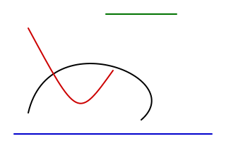

# 贝塞尔曲线（Bezier Curve）for Pinta

[](../../actions/workflows/build.yml)

一个 Pinta 插件，提供**贝塞尔曲线工具**，交互方式参考 KolourPaint 的曲线工具：
先拖出一条线，再用一个或两个控制点把它弯成曲线。



支持 **Pinta 3.1**，Linux / macOS / Windows 均可作为普通插件安装，不需要修改 Pinta
源码。

## 安装

1. 从 [Releases](../../releases/latest) 下载
   `PintaExtension-BezierCurve-<version>.mpack`。
2. 在 Pinta 中打开 **插件 → 插件 → 从文件安装…**，选择 `.mpack`。
3. 重启 Pinta。工具箱中 *Line/Curve* 后面会出现 **Bezier** 工具（快捷键 **V**）。

卸载：**插件 → 插件 → 已安装 →** 移除 *Bezier Curve*。

> 直接把 DLL 复制到 `~/.config/Pinta/addins/` **不行**：那个目录是 Mono.Addins 的
> 注册表，不是扫描目录。

## 使用

| 操作 | 结果 |
|---|---|
| 左键拖动 | 确定起点和终点，用主色绘制 |
| 右键拖动 | 同上，用副色绘制 |
| 再次拖动（同一键） | 放置第一个控制点 |
| 再拖动一次 | 放置第二个控制点，曲线完成，仍可调整 |
| 拖动端点或控制点 | 调整曲线（可抓取时标记会高亮，光标会变化） |
| **Enter** | 完成当前曲线 |
| **Backspace** / **Delete** | 撤回最后一个点（并取消直线） |
| **方向键**（Shift = 10 px） | 微调高亮的点 |
| 在别处拖动 | 完成当前曲线并开始下一条 |
| 点击**另一个**键 | 提前完成：2 个点得到直线，3 个点得到单控制点曲线 |
| 再次点击唯一的控制点 | 完成三点曲线（MS Paint 的做法） |
| 拖线时按 **Shift** | 吸附到 0° / 45° / 90°（状态栏显示角度） |
| 拖线时按 **Ctrl** | 吸附到 0° / 30° / 60° / 90° |
| **Shift + Ctrl** | 吸附到 0° / 30° / 45° / 60° / 90° |
| 放控制点时按 **Shift** | 吸附到构造点 |
| 放控制点时按 **Ctrl** | 吸附到端点切线 |
| **C** | 闭合曲线 |
| **F** | 填充闭合曲线 |
| **Esc** | 取消当前曲线 |
| **Ctrl + E** | 重新拾起最近提交的曲线 |
| `[` / `]` | 减小 / 增大笔宽 |
| 虚线框 | 用 Pinta 的虚线/间隔写法设置虚线（默认实线） |
| Behaviour 框 | 曲线完成后的行为（见下） |
| Commit 框 | 何时提交曲线（见下） |
| 齿轮按钮 | 描边、形状、对称选项 |
| 旁边的按钮 | 重新拾起最近提交的曲线 |
| 切换工具或文档 | 提交当前曲线（与 KolourPaint 一致） |

绘制时，状态栏显示正在放置的点、点数、完成后的尺寸和吸附角度。

### 两种行为

- **KolourPaint**：曲线完成后就是像素，不能再改。
- **MS Paint**：曲线完成后保留为对象，带虚线框，可以移动、缩放、旋转、翻转，并在
  框还在时实时改样式。

### 描边样式

齿轮按钮打开样式面板：端点形状、连接方式、渐变、锥形宽度、虚线、闭合、填充、对称、
像素对齐。

## 从源码构建

需要 .NET 8 SDK 和 git。Pinta 会被克隆到 `.pinta/`（已 gitignore），因为编译插件只需要
`Pinta.Core`：

```bash
./scripts/bootstrap-pinta.sh          # 克隆并构建 Pinta 3.1 到 .pinta/Pinta
dotnet build src/TheMorbidArk.PintaExtension.BezierCurve/TheMorbidArk.PintaExtension.BezierCurve.csproj
./scripts/make-mpack.sh               # -> dist/PintaExtension-BezierCurve-<version>.mpack
```

如果 Pinta 在别处：

```bash
PINTA_SRC=/path/to/Pinta ./scripts/bootstrap-pinta.sh
# 或：dotnet build -p:PintaSourceDir=/path/to/Pinta
```

开发安装（把插件复制到 Pinta 可执行文件旁边，这是调试插件唯一会被加载的位置）：

```bash
./scripts/dev-install.sh
```

## 测试

```bash
dotnet test src/TheMorbidArk.PintaExtension.BezierCurve.Tests
./scripts/smoke-test.sh
./scripts/package-test.sh
```

## 已知限制

- 只有**最后一条**提交的曲线能重新拾起；更早的曲线已经是图像的一部分。
- `PintaCore.Chrome.SetStatusBarText` 是具体类上的公共方法，不在 `IChromeService`
  里，状态栏消息依赖一个略非正式的 API。

## 文档

- [手动检查清单](docs/zh-CN/manual-checklist.md)
- [设计笔记](docs/design/)（中文）

## 致谢 / Acknowledgements

本项目的完成离不开以下工具、模型与社区的支持：

- **开发辅助**：感谢 **DeepSeek V4.1 Flash 1017** 在代码实现、文档撰写与调试过程中提供的辅助。
- **核心依赖**：本项目基于 **Pinta 3.1** 的插件 API 构建，使用 **Mono.Addins** 与 **GTK#/Cairo**。
- **上游项目**：交互模型与角度吸附算法参考自 **KolourPaint**（`tools/polygonal/kpToolCurve.cpp`、`kpToolPolygonalBase.cpp`，© Clarence Dang，BSD-2-Clause）。这里的实现是独立编写的 C#；图标按 Pinta 风格从零绘制。
- **社区贡献者**：感谢所有通过 Issue、PR 和讨论为本项目做出贡献的开发者。

## 许可证

MIT，见 [LICENSE](LICENSE)。
