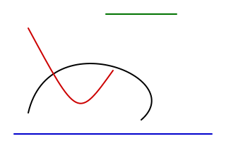

# KolourPaint 曲线工具 → Pinta 插件移植：可行性分析报告

> 结论先行：**可行，且不需要修改 Pinta 源码。** 但**必须走“独立 BaseTool”路线**，Pinta 现有的“形状工具 / ShapeEngine”体系对插件是封闭的（下文有三条路线的编译级实测证据）。
>
> 已完成端到端验证：插件在 Pinta 3.1 中加载成功、工具箱出现 “Bezier” 工具、KolourPaint 的 2/3/4 点语义与右键收尾行为全部正确，实时预览与撤销接入正常（见 `docs/images/`）。

---

## 0.1 实现状态（本报告的结论已落地）

报告结论已按**路线 A** 实现完成并通过自动化验证：

| 交付物 | 位置 |
|---|---|
| 插件源码 | `src/TheMorbidArk.PintaExtension.BezierCurve/`（仅引用 `Pinta.Core`，931 行含注释） |
| 单元测试 | `src/TheMorbidArk.PintaExtension.BezierCurve.Tests/`（几何、吸附、本地化，37 项，无需图形环境） |
| 无头端到端测试 | `src/TheMorbidArk.PintaExtension.BezierCurve.SmokeTest/` + `scripts/smoke-test.sh` |
| 交付链路测试 | `scripts/package-test.sh`（打包 → 装进注册表 → 重启加载 → 卸载 → 再重启） |
| 使用/开发文档 | `README.md` |
| 打包工具 | `tools/mpack/`（Mono.Addins.Setup 的薄封装） |

自动化断言共 33 项 + 交付链路 3 项，全部 PASS，覆盖：几何与角度吸附（0/30/45/60/90 与分界角）、
2/3/4 点语义、右键收尾、Escape 取消、实时预览不污染图层、撤销/重做、控制点手柄渲染、
图标解析、中英文本地化。

**交付形态的重要修正**：插件必须是**单文件**（图标以嵌入资源形式随 DLL 分发，运行时解包到
`~/.cache/pinta-extension/bezier-curve/<版本>/icons` 再加入 GTK 图标搜索路径）。早期把图标作为独立文件放进
`.mpack` 的版本会让 Mono.Addins 卸载时删不干净（残留图标文件 + 残留注册表项），下次启动 Pinta 时
抛 `FileNotFoundException: Could not load file or assembly 'TheMorbidArk.PintaExtension.BezierCurve'`。改为单文件后，
「安装 → 加载 → 卸载 → 重启」全链路无残留、无崩溃（`scripts/package-test.sh` 覆盖）。

> 下文 §2–§8 是决策阶段的可行性分析（保留原貌）。文中提到的探针代码已被 `src/` 的正式实现
> 取代，仅 `docs/probe/` 保留了「路线 B 不可行」的最小复现文件。

---

## 0. 结论摘要

| 项目 | 判定 | 说明 |
|---|---|---|
| 插件能否新增一个**全新工具** | ✅ 可以 | `IToolService.AddTool(BaseTool)`，只需 `Pinta.Core` |
| KolourPaint 曲线语义能否**忠实还原** | ✅ 可以 | Qt `cubicTo` → Cairo `CurveTo`，1:1 映射 |
| 能否复用 Pinta 的**形状编辑引擎**（控制点手柄、形状持久化、形状级撤销） | ❌ **不可行** | `ShapeEngine.GeneratedPoints` 等成员为 `private protected` / `internal set`，插件无法实现自定义几何；`ShapeTypes` 为封闭枚举且与内置工具 1:1 绑定 |
| 是否需要改 Pinta 源码 | ❌ 不需要 | 纯插件即可；后续若想“上游化”为内置工具，改动也很小 |
| 实测编译 | ✅ 通过 | `dotnet build`，0 error / 0 warning |
| 实测运行 | ✅ 通过 | Pinta 3.1 + Xvfb 无头运行，工具注册、绘制、预览全部验证 |
| 工作量估算 | ≈ 3–5 人日 | 核心工具 1–2 日，打磨（图标/i18n/打包/边界）2–3 日 |

**推荐路线：路线 A — 以 `BaseTool` 子类独立实现，内部自带“点集合 + 三次贝塞尔状态机 + ToolLayer 预览 + SimpleHistoryItem 撤销”。**

---

## 1. 调研范围与验证环境

| 项 | 值 |
|---|---|
| Pinta 源码 | Pinta 3.1（tag `3.1`），由 `scripts/bootstrap-pinta.sh` 克隆到 `.pinta/Pinta` |
| 参考插件 | 官方 Pinta Demo Add-in（用于确认插件工程可编译、可加载） |
| 源工具 | KolourPaint `tools/polygonal/kpToolCurve.{h,cpp}`（147+30 行）+ `kpToolPolygonalBase.cpp`（425 行基类） |
| 运行时 | .NET 8.0.423 / GTK4 via GirCore 0.7.0 / Mono.Addins 1.4.2-alpha.4 |
| 验证方式 | 编译验证 + Pinta 真实启动（`xvfb-run`）+ 通过 `IToolService` 合成鼠标事件自动绘制 + 图层导出 PNG 目视核对 |

---

## 2. 源工具剖析（KolourPaint）

### 2.1 曲线绘制核心（`kpToolCurve.cpp` 中的 `DrawCurveShape`）

```cpp
switch (points.count()) {
case 2: controlPointP = startPoint; controlPointQ = endPoint;   break; // 直线
case 3: controlPointP = controlPointQ = points[2];              break; // 二次曲线
case 4: controlPointP = points[2]; controlPointQ = points[3];   break; // 三次贝塞尔
}
QPainterPath p; p.moveTo(startPoint);
p.cubicTo(controlPointP, controlPointQ, endPoint);
painter.strokePath(p, painter.pen());
```

**要点**：整条曲线永远是“1 段三次贝塞尔”，4 个点里只有前两个是曲线上的点（端点），后两个是离曲线控制点（off-curve）。这与 Pinta 的 `LineCurveSeriesEngine`（所有控制点都在曲线上、基数样条 cardianl spline）**语义完全不同**。

### 2.2 交互状态机（`kpToolPolygonalBase::beginDraw/draw/endDraw`）

| 阶段 | 用户动作 | 内部行为 | 提示语 |
|---|---|---|---|
| 空闲 | 按下起始键并拖拽 | `points = [start, start]`，末端跟随鼠标 | “拖出起点和终点” |
| 2 点 | 松开 | 保留直线 | “左键拖拽设置第一个控制点，或右键结束” |
| 2 点 | 同键按下并拖拽 | `points += [pos]`，末端跟随鼠标 | — |
| 3 点 | 松开 | 二次曲线形态 | “左键拖拽设置最后一个控制点，或右键结束” |
| 3 点 | 同键按下并拖拽 | `points += [pos]` | — |
| 4 点 | 松开 | **自动提交**（`endShape()`） | 回到“拖出起点和终点” |
| 任意 ≥2 点 | 按下**另一个**键 | **立即提交**（右键结束） | — |

其它细节：
- 颜色取自**起始按键**（左键=前景色，右键=背景色）；用于结束的另一个键不改变颜色。
- 画笔：`QPen(color, penWidth, SolidLine, RoundCap, RoundJoin)`。
- 修饰键（`applyModifiers`）：Shift 吸附 45°，Ctrl 吸附 30°，Shift+Ctrl 取 30/45/60 中最接近者；Alt 居中已被作者禁用。
- 预览：画在 `kpTempImage`（临时图层）上，不改动原图；提交时才写入文档并压入 `kpToolPolygonalCommand`（撤销）。
- 单像素特殊处理：所有点重合时 `drawPoint` 代替 `strokePath`。

---

## 3. 目标平台能力盘点（Pinta 3.1）

### 3.1 插件（Add-in）机制 — 完全够用

```csharp
[Mono.Addins.Extension]
public sealed class CurveExtension : IExtension {
    public void Initialize ()   => PintaCore.Tools.AddTool (new CurveTool (PintaCore.Services));
    public void Uninitialize () => PintaCore.Tools.RemoveInstanceOfTool<CurveTool> ();
}
```

- 清单：嵌入式 `.addin.xml`（`<Addin id="…" version="…">` + `<Dependencies><Addin id="Pinta" version="3.1"/></Dependencies>`）。
- 扩展点：`Pinta.Core.IExtension`（`[TypeExtensionPoint]`），由 `Pinta/MainWindow.cs:97` 的 `AddinManager.AddExtensionNodeHandler` 加载。
- **工具就是扩展点**：`BaseTool` 本身就是 `[Mono.Addins.TypeExtensionPoint]`（`Pinta.Core/Classes/BaseTool.cs:35`）；`IToolService.AddTool` 会创建工具箱按钮、排序、注册快捷键、构建工具条。

### 3.2 BaseTool 生命周期（插件可用的钩子，全部 `protected virtual`）

```
OnBuildToolBar(tb) ← 选中工具时构建工具栏
OnActivated(doc) / OnDeactivated(doc,newTool)
OnMouseDown / OnMouseMove / OnMouseUp   (ToolMouseEventArgs)
OnKeyDown / OnKeyUp
OnCommit(doc)           ← 切文档（PreActiveDocumentChanged）时被调用
OnHandleUndo/Redo, OnAfterUndo/Redo, OnAfterSave
OnSaveSettings(settings)
ToolItem / Handles / DefaultCursor / Icon / ShortcutKey / Priority / ShowAntialiasingButton …
```

`DoBuildToolBar` 在 `OnBuildToolBar` 之后会**自动**追加抗锯齿、Alpha 混合下拉框（取决于 `ShowAntialiasingButton` / `ShowAlphaBlendingButton`）——正好对应 KolourPaint 的“抗锯齿”全局开关。

### 3.3 可直接复用的基础设施（全部位于 `Pinta.Core`，无需引用 `Pinta.Tools`）

| 能力 | API | 备注 |
|---|---|---|
| 临时预览层 | `document.Layers.ToolLayer`、`document.CreateClippedToolContext()` | 独立 Layer，自动合成在“当前图层”之上，且受选区裁剪 |
| 正式绘制上下文 | `document.CreateClippedContext()` | 已应用选区裁剪 |
| 撤销 | `new SimpleHistoryItem (Icon, Name, undoSurface, layerIndex)` | 内部 `SurfaceDiff` 做差分优化，全 Pinta 画笔工具都用它 |
| 颜色 | `IPaletteService.PrimaryColor / SecondaryColor` | — |
| 笔宽控件 | `GtkExtensions.CreateToolBarSpinButton(1, 1e5, 1, 默认值)` | 与内置工具同款 |
| 光标位图 | `Resources.GetIcon ("Cursor.Line.png")` + `Gdk.Cursor.NewFromTexture` | 复用 Pinta 自带光标 |
| 状态栏 | `PintaCore.Chrome.SetStatusBarText (…)` | ⚠️ 在具体类型 `ChromeManager` 上，`IChromeService` 未暴露 |
| 恒定屏幕尺寸手柄 | `IToolHandle`（`BaseTool.Handles`） | `PintaCanvas.cs:276` 绘制，可作为“控制点小圆点”的可选增强 |
| 设置持久化 | `ISettingsService.GetSetting/PutSetting` | 需自建命名空间（如 `BezierCurve.BrushWidth`） |
| 脏区刷新 | `document.Workspace.Invalidate (RectangleI)` | — |

### 3.4 现成的“形状工具”体系 —— 及其对插件的**封闭点**

Pinta 的形状工具栈：`ShapeTool : BaseTool` → `BaseEditEngine`（控制点状态机、手柄、工具栏、历史）→ `ShapeEngine`（几何 + 可重编辑图层）。

设计上很好，但**从插件程序集（另一个 assembly）看是封闭的**：

| 成员 | 声明 | 对插件的后果 |
|---|---|---|
| `ShapeEngine.GeneratedPoints` | `public GeneratedPoint[] { get; private protected set; }`（`ShapeEngineCollection.cs:100`） | `private protected` = 派生类**且同程序集** ⇒ 插件无法产出自定义几何。**这是致命阻塞点** |
| `ShapeEngine.BrushWidth / AntiAliasing / DashPattern / OutlineColor / FillColor` | `{ get; internal set; }`（:108/:109/:115 …） | 插件只能读，无法响应工具栏变更 |
| `BaseEditEngine.ShapeTypes` | `public enum`（`BaseEditEngine.cs:41`） | 封闭枚举，插件不能新增形状类型 |
| `BaseEditEngine.CorrespondingTools` | `static Dictionary<ShapeTypes, ShapeTool>`（:49） | 形状类型 ↔ 工具 1:1 全局映射；4 个值都被内置工具占用。抢占某一项会让内置工具被“踢”给插件 |
| `BaseEditEngine.ActivateCorrespondingTool`（:1486/:1504） | `DrawActiveShape`（:1012）内部调用 | 若插件形状沿用 `OpenLineCurveSeries`，每次重绘都会被切到 `LineCurveTool`，形成工具互踢 |
| `BaseEditEngine.SEngines` | `public static Collection<ShapeEngine>`（:182） | 所有形状工具共享的全局静态集合 |
| `BaseEditEngine.DrawActiveShape` | **非 virtual** | 想绕开上述逻辑只能整段重写鼠标/绘制管线，等于放弃复用 |

---

## 4. 三条技术路线评估（含实测证据）

### 路线 A ✅ 独立 `BaseTool`（推荐）

插件自带状态机与几何，只依赖 `Pinta.Core`。

**实测证据 1 — 编译**：探针工程仅引用 `Pinta.Core`，`dotnet build` 0 error / 0 warning（正式实现见 `src/TheMorbidArk.PintaExtension.BezierCurve/`）。

**实测证据 2 — 运行**：把 DLL 放到 Pinta 的 `bin` 后启动（Xvfb 无头）：

```
hasIcon(tool-curve)=True dir=…/bin/icons
Initialize: tool added
document created 320x200
OnActivated
current tool = CurveTool
toolbox tool count=23
tool item icon=tool-curve name=Curve
tooltip=Curve | Shortcut key: V |  | Draws curves
curve 1 drawn (4 points)
curve 2 drawn (3 points + right click)
mid-drag: tool_layer_visible=True, preview saved
curve 3 drawn (line)
DONE
```

**实测证据 3 — 像素级结果**（`docs/images/curve-result.png`，直接导出“当前图层”）：



- 黑色：4 点三次贝塞尔 ✔
- 红色：3 点（两控制点重合）+ 右键收尾 ✔
- 蓝色：2 点直线 ✔

**实测证据 4 — 实时预览**（拖拽中途导出 `ToolLayer`，`docs/images/preview.png`）：


预览只存在于 ToolLayer，原图层未被污染（与 KolourPaint 的 `kpTempImage` 语义一致）。

### 路线 B ❌ 继承 `ShapeEngine` 复用形状引擎

探针代码 `docs/probe/ShapeEngine-probe-fails.cs.txt` 的编译结果（只有 4 个错误，全部是访问权限）：

```
error CS0200: 无法为属性或索引器“ShapeEngine.GeneratedPoints”赋值 - 它是只读的
error CS0200: 无法为属性或索引器“ShapeEngine.BrushWidth”赋值 - 它是只读的
error CS0200: 无法为属性或索引器“ShapeEngine.AntiAliasing”赋值 - 它是只读的
error CS0200: 无法为属性或索引器“ShapeEngine.DashPattern”赋值 - 它是只读的
```

（顺带验证：`(BaseEditEngine.ShapeTypes) 4` 这种“枚举外值”在 C# 里是合法的，可以用它绕开 `CorrespondingTools` 的工具互踢——但即使绕开这一点，`GeneratedPoints` 仍然写不进去。）

理论上可以用反射写 `GeneratedPoints` 的私有 setter 强行突破，但那属于依赖实现细节的脆弱 hack，**不建议**。

### 路线 C ❌ 直接复用 `LineCurveSeriesEngine`

`LineCurveSeriesEngine` 是 **cardinal spline（所有点都在曲线上）**，无法表达 KolourPaint “端点 + 离曲线控制点”的语义。用它做出来的是另一个工具，不是移植。

> 另外，路线 C 还有个隐患：`ShapeEngine.DashPattern`、`Arrow`、`FillStyle` 等工具栏项会一并出现，与 KolourPaint 曲线工具的极简工具栏不符。

---

## 5. 推荐方案（路线 A）的实现设计

### 5.1 状态机（映射 `kpToolPolygonalBase`）

```
None ──MouseDown(任意键)──► DraggingLine   points=[p,p]
DraggingLine ──MouseUp──► AwaitingControl1   (2 点，可右键结束=直线)
AwaitingControl1 ──MouseDown(同键)──► DraggingControl1  points+=p
AwaitingControl1 ──MouseDown(异键)──► Commit
DraggingControl1 ──MouseUp──► AwaitingControl2 (3 点)
AwaitingControl2 ──MouseDown(同键)──► DraggingControl2  points+=p
AwaitingControl2 ──MouseDown(异键)──► Commit
DraggingControl2 ──MouseUp──► Commit (4 点，自动完成)
任意阶段 ──Escape / 工具切换 / 文档切换──► Cancel 或 Commit
```

实现上不必真的用枚举：用 `points.Count`（2/3/4）+ `drag_button`/`originating_button` 就能等价表达（spike 已如此实现）。

### 5.2 Qt → Cairo 关键映射

| KolourPaint (Qt) | Pinta (Cairo / GirCore) |
|---|---|
| `QPolygon points` (2..4) | `List<PointD> points`（`Pinta.Core.PointD`） |
| `painter.setPen(QPen(c, w, SolidLine, RoundCap, RoundJoin))` | `g.LineWidth = w; g.LineCap = LineCap.Round; g.LineJoin = LineJoin.Round;` |
| `setRenderHint(Antialiasing)` | `g.Antialias = UseAntialiasing ? Antialias.Subpixel : Antialias.None;` |
| `path.moveTo(start); path.cubicTo(cp1, cp2, end)` | `g.MoveTo(...); g.CurveTo(cp1, cp2, end); g.Stroke();` |
| `kpTempImage` 临时图层 | `document.Layers.ToolLayer` + `Hidden=false` + `CreateClippedToolContext()` |
| `kpToolPolygonalCommand` 撤销 | `new SimpleHistoryItem (Icon, Name, undoLayerSurface, layerIndex)` |
| `color(originatingMouseButton())` | `originating_button == Right ? palette.SecondaryColor : palette.PrimaryColor` |
| `applyModifiers()`（Shift 45°/Ctrl 30°） | 自实现 `ClampToAngles()`（spike 已含 Shift 45°） |
| `neededRect(bounding, penWidth)` | 控制点包围盒 `RectangleD.FromPoints(...).Inflated(width+4, width+4)` → `ClampToImageSize().ToInt()` |

### 5.3 脏矩形与刷新

- 预览：先 `ToolLayer.Clear()`，再描边，再 `Invalidate(union(新脏区, 上一帧脏区))`。
- 提交：`ToolLayer.Clear() + Hidden=true`，用 `CreateClippedContext()` 画到当前图层，`Invalidate(脏区)`，压历史项。
- 初始 2 点拖拽时用 Shift 吸附后，注意脏区要包含吸附前的位置（与上一帧 union 已覆盖）。

### 5.4 工具栏 / 图标 / 快捷键 / 状态栏

- 工具栏：`基类自动给抗锯齿 + Alpha 混合下拉` + 自定义笔宽 SpinButton（`CreateToolBarSpinButton`）。**不提供**填充样式、箭头、虚线（KolourPaint 也没有）。
- 图标：KolourPaint 自带 `pics/action/{16,22,32,48}-actions-tool_curve.png` 与 `sc-actions-tool_curve.svgz`（BSD-2-Clause，可合法再分发）。做法：随插件发布 `icons/hicolor/<N>x<N>/actions/tool-curve.png`（或自绘一个 Pinta 风格 `tool-bezier-curve-symbolic.svg`，用 `currentColor` 更贴合 Pinta 主题），并在 `Initialize()` 里
  `GtkExtensions.GetDefaultIconTheme().AddSearchPath(<插件目录>/icons);`
  —— **已实测** `HasIcon("tool-curve") = True` 且工具箱按钮正确显示。
- 快捷键：`V` 目前**空闲**（内置工具占用 M/Z/H/S/B/P/E/F/G/K/T/O/L/R），与 KolourPaint 一致。
- 排序：`Priority = 38`（`LineCurveTool=37`，`RectangleTool=39`），紧跟“Line/Curve”之后。
- 状态栏：随阶段更新提示语（KolourPaint 的 `setUserMessage`）。

### 5.5 边界情况清单

| 场景 | 处理 |
|---|---|
| 工具切换 / 文档切换 | `OnCommit`（Pinta 在 `PreActiveDocumentChanged` 时调用）提交；`OnDeactivated` 取消并清空 ToolLayer |
| Escape | 取消当前曲线，清空预览 |
| 选区 | `CreateClipped*Context()` 已自动裁剪 |
| Alpha 混合开关 | `UseAlphaBlending ? Normal : Source` |
| 关闭抗锯齿 | `Antialias.None`；需实测像素中心对齐（Cairo 矢量描边 vs Qt 整数坐标，可能需要 ±0.5 偏移微调） |
| 所有点重合 | Cairo 圆头零长路径会画出圆点，与 KolourPaint 的 `drawPoint` 效果等价（建议保留显式分支以便关闭抗锯齿时逐像素准确） |
| 撤销 | 整层 `SimpleHistoryItem`（内部 SurfaceDiff 差分，开销可控） |
| 设置持久化 | 自建键名前缀 `PintaExtension.BezierCurve.*`，避免与 Pinta 内置键冲突 |

### 5.6 建议的工程结构

```
PintaExtension-BezierCurve/
├─ src/
│  └─ TheMorbidArk.PintaExtension.BezierCurve/
│     ├─ TheMorbidArk.PintaExtension.BezierCurve.csproj          # 仅引 Pinta.Core + Mono.Addins
│     ├─ .addin.xml                   # 嵌入式清单，依赖 Pinta 3.1
│     ├─ CurveAddin.cs                # IExtension：注册工具 + 图标搜索路径
│     ├─ CurveTool.cs               # BaseTool 子类：状态机 + 工具栏 + 键鼠
│     ├─ CurveGeometry.cs             # 纯函数：贝塞尔插值 / 角度吸附 / 脏矩形（可单测）
│     └─ Resources/
│        ├─ icons/hicolor/…/tool-bezier-curve[-symbolic].{svg,png}
│        └─ Language.resx (+ Language.zh-Hans.resx …)
└─ scripts/                           # bootstrap / 打包 / 测试脚本
```

### 5.7 分发方式（重要实测发现）

| 方式 | 结果 |
|---|---|
| DLL 放到 Pinta 安装目录（`bin`） | ✅ **实测可加载**（开发期最省事，官方 Demo 也是这么说的） |
| DLL 直接丢进 `~/.config/Pinta/addins/` | ❌ **实测不加载**（该目录是 Mono.Addins 的注册数据库目录，只由安装器写入，不会自动扫描目录） |
| 打包成 `.mpack`，用 Pinta「Add-ins → Install from file」安装 | ✅ 官方路径（`Pinta.Gui.Addins/AddinManagerDialog.cs:241` 有 `*.mpack` 过滤器） |

⇒ 交付形态应为 **`.mpack`**（开发期则直接拷进 `bin`）。

---

## 6. 交互语义映射表

| KolourPaint | 移植实现 | 备注 |
|---|---|---|
| 左键拖拽 = 起点→终点，用前景色 | 同 | 起始键决定颜色 |
| 右键拖拽 = 起点→终点，用背景色 | 同 | — |
| 后续每次拖拽 = 增加一个控制点 | 同 | 第 1 个 → 二次形态；第 2 个 → 三次形态 |
| 4 点后自动完成 | 同 | — |
| 另一个键单击 = 结束（2 点即直线） | 同 | 实测红线/蓝线即此路径 |
| Shift 吸附 45° | ✅ 已实现 | `ClampToAngles` |
| Ctrl 吸附 30°、Shift+Ctrl 取 30/45/60 | ⏳ 待补 | 移植 `applyModifiers` 的 tan 阈值判定 |
| 状态栏分阶段提示 | ✅ 已实现 | 走 `PintaCore.Chrome.SetStatusBarText` |
| 抗锯齿开关（全局） | ✅ 用 Pinta 每工具抗锯齿下拉 | 语义一致 |
| 线宽下拉 | ✅ 换成 Pinta 的 SpinButton | 1–1e5 |
| 临时图层预览 | ✅ ToolLayer | 原图不受污染 |
| 撤销 | ✅ SimpleHistoryItem | 与内置画笔工具一致 |

**Pinta 侧可选增强（非 KolourPaint 原生）**：用 `IToolHandle` 在拖控制点时画一个跟随的小圆点/辅助线，让“控制点在哪”更直观；这不影响语义兼容性。

---

## 7. 工作量估算

| 阶段 | 内容 | 估时 |
|---|---|---|
| M1 骨架 | 工程 + `.addin.xml` + 注册/注销 + 图标 + 工具栏 + 光标 | 0.5 日 |
| M2 绘制与预览 | 几何、ToolLayer 预览、脏矩形、抗锯齿/混合、线宽 | 1 日 |
| M3 交互状态机 | 2/3/4 点、异键结束、Escape、Shift/Ctrl 吸附、状态栏提示 | 1 日 |
| M4 集成与打磨 | 撤销、设置持久化、文档/工具切换、单像素与关闭抗锯齿的像素校准 | 1 日 |
| M5 发布 | i18n（resx）、`.mpack` 打包、README、Xvfb 冒烟测试脚本 | 1 日 |
| **合计** | | **≈ 3–5 人日** |

> 对比：若走路线 B（复用形状引擎），需要上游修改 Pinta（把 `GeneratedPoints`/`BrushWidth` 等改为 `public set` 或引入“扩展形状类型”机制），属跨仓库改动，风险与周期都远高于路线 A。

---

## 8. 风险与限制

| 风险 | 等级 | 说明 / 缓解 |
|---|---|---|
| 插件 API 面偏“非契约” | 中 | `Time` 用到 `PintaCore.Tools/Workspace/Palette/Chrome` 等静态单例；`IChromeService` 未暴露 `SetStatusBarText`。建议把这几个调用收敛到一处适配层，便于 Pinta 升级时单点修复 |
| Pinta 内部重构 | 低 | `BaseTool` 的虚方法、`IToolService.AddTool`、`SimpleHistoryItem`、`ToolLayer` 都是内置工具自身依赖的稳定面 |
| 关闭抗锯齿时的像素对齐 | 低 | Cairo 矢量描边与 Qt 整数光栅化存在半像素差异，M4 阶段用导出的 PNG 逐像素比对微调 |
| 撤销粒度 | 低 | 每条曲线一个历史项；`SimpleHistoryItem` 内部有 `SurfaceDiff` 差分，不会整层冗余 |
| ToolLayer 共享 | 低 | 它是全工具共用的暂存层；提交/取消/失活时必须 `Clear() + Hidden=true`（spike 已处理） |
| 许可证 | 低 | KolourPaint 为 **BSD-2-Clause**（`kpToolCurve.cpp` 头部 SPDX），与 Pinta 的 MIT 兼容；分发时保留原版权声明即可 |
| i18n | 低 | `AddinManager.CurrentLocalizer` 需把 `Language.resx`（及 `Language.<culture>.resx`）正确嵌入插件程序集（Demo 的 resx 因 `EnableDefaultEmbeddedResourceItems=false` 实际未生效，需自己显式 `<EmbeddedResource>`） |

---

## 9. 附录

### 9.1 本报告的证据文件

| 文件 | 说明 |
|---|---|
| `src/TheMorbidArk.PintaExtension.BezierCurve/` | 路线 A 的正式实现（931 行含注释） |
| `src/TheMorbidArk.PintaExtension.BezierCurve.Tests/` | 几何/吸附/本地化单元测试（37 项） |
| `src/TheMorbidArk.PintaExtension.BezierCurve.SmokeTest/` | 无头端到端测试 add-in：建文档 → 合成鼠标事件 → 导出 PNG |
| `docs/probe/ShapeEngine-probe-fails.cs.txt` | 路线 B 的失败探针（改回 `.cs` + 加 `Pinta.Tools` 引用即可复现 4 条 `CS0200`） |
| `docs/images/curve-result.png` | 三种曲线形态的最终渲染结果 |
| `docs/images/preview.png` | 拖拽中途的 ToolLayer 预览（原图未受影响） |
| `docs/images/handles.png` | 控制点手柄的渲染结果 |

### 9.2 复现步骤（开发期）

```bash
# 1) 构建 Pinta（一次即可，克隆到 .pinta/Pinta）
./scripts/bootstrap-pinta.sh

# 2) 构建插件并把 DLL（+ icons/ 目录）拷到 Pinta 的 bin
cd <插件工程目录>
dotnet build
cp bin/Debug/net8.0/<Addin>.dll "<Pinta>/build/bin/"
cp -r icons/. "<Pinta>/build/bin/icons/"   # 图标（hicolor/…/actions/tool-curve.png），注意 /. 避免套娃

# 3) 启动
cd "<Pinta>/build/bin" && dotnet Pinta.dll
# 无头验证：
XDG_CONFIG_HOME=/tmp/cfg GDK_BACKEND=x11 xvfb-run -a dotnet Pinta.dll
```

### 9.3 是否要“上游化”？

如果目标不止于“插件能跑”，而是希望成为 Pinta 自带工具：

- 内置方式改动极小：新增 `Pinta.Tools/Tools/CurveTool.cs`（或直接复用路线 A 的代码）+ 在 `CoreToolsExtension.Initialize()` 里 `AddTool` 一行 + 图标放进 `Pinta.Resources/icons`。
- 如果坚持要走“形状工具”体系，则必须先在上游把 `ShapeEngine` 的扩展点打开（`GeneratedPoints` 可写、`ShapeTypes` 可扩展），这属于 Pinta 自身的架构改动，建议单独提 issue/PR 讨论。

---

*报告基于 Pinta 3.1 与 KolourPaint 主分支源码实测；所有“实测”结论都可由 `scripts/smoke-test.sh` / `scripts/package-test.sh` 复现。*
